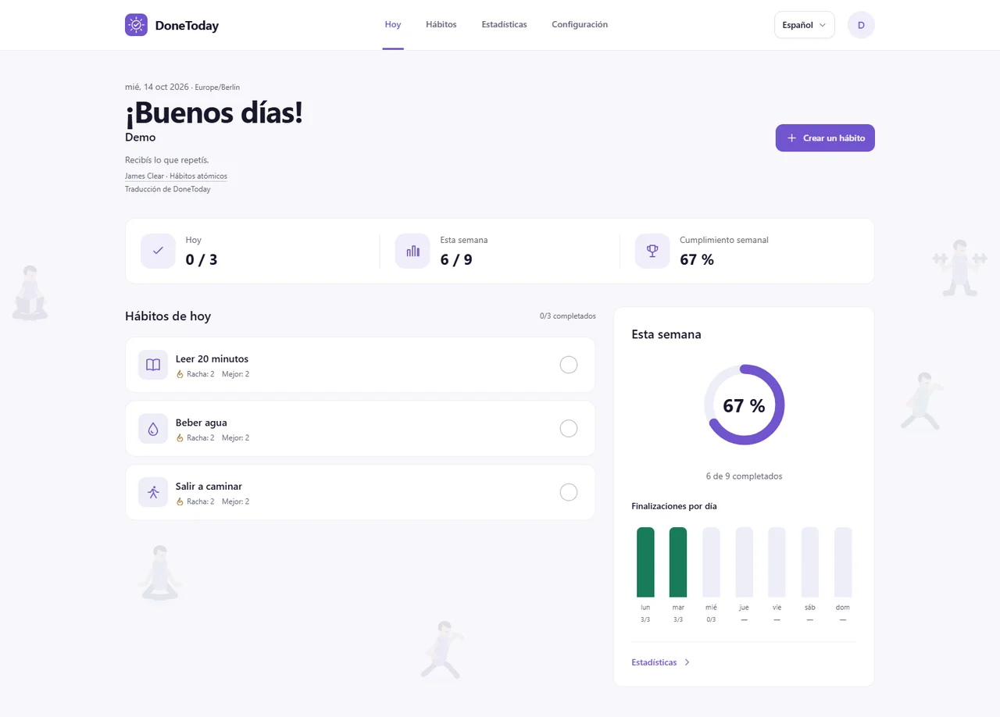
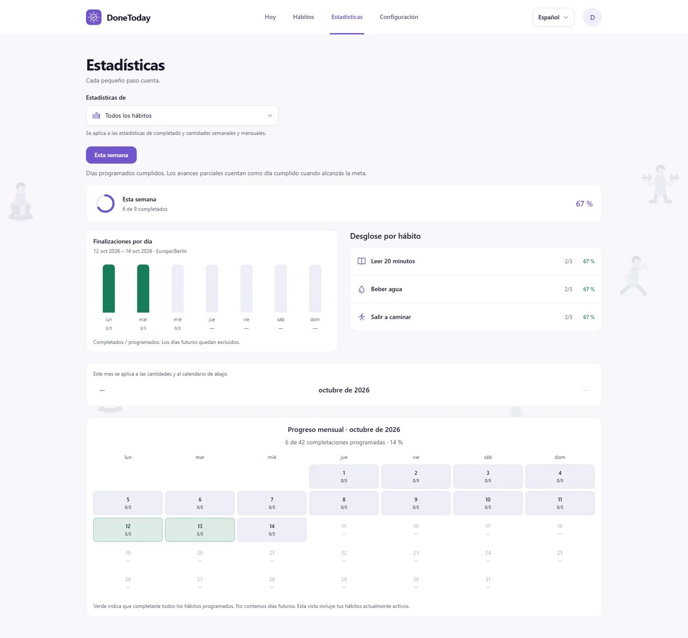
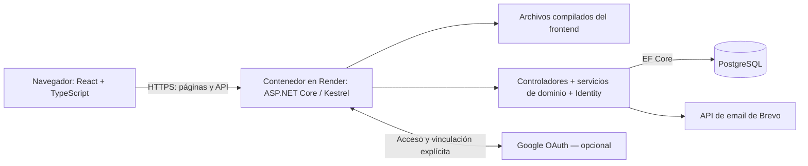

# DoneToday

[](https://github.com/EliasOlguin/DoneToday/actions/workflows/ci.yml)

Una aplicación de hábitos para quienes quieren crear rutinas, registrar sus avances diarios y entender su constancia a lo largo del tiempo.

[Read in English](README.md)

## Capturas

### Hoy: hábitos programados, rachas y progreso semanal



### Estadísticas: completados diarios, desglose por hábito y calendario mensual



Las capturas usan una sola cuenta de demo local con tres semanas de historial variado y una fecha de referencia común: 21 de octubre de 2026. Muestran la interfaz en español; también está disponible en inglés y alemán.

## Demo en vivo

[Abrir DoneToday](https://donetoday-15xl.onrender.com)

El hosting gratuito de Render se suspende por inactividad; la primera carga puede tardar alrededor de un minuto.

Podés explorar con la opción de invitado sin registrarte o crear una cuenta con confirmación de email. El acceso con Google está disponible cuando se configuran las credenciales del proveedor.

## Tecnologías

| Área | Tecnología |
| --- | --- |
| Frontend | React 19, TypeScript 6, Vite 8, Tailwind CSS 4 |
| Navegación y datos del servidor | React Router, TanStack Query |
| Idiomas | i18next y react-i18next; inglés, español y alemán |
| Backend | ASP.NET Core 10, Kestrel, Entity Framework Core 10 |
| Base de datos y cuentas | PostgreSQL, ASP.NET Core Identity, autenticación por cookies y 2FA opcional con autenticador |
| Email | MailKit/SMTP; Brevo en el despliegue de Render |
| Despliegue | Compilación Docker por etapas; la API sirve los archivos del frontend en Render |
| Tests | xUnit, Vitest, Testing Library y el ejecutor de tests de Node.js |

## Decisiones técnicas

| Decisión | Por qué importa | Código para revisar |
| --- | --- | --- |
| **Una zona horaria por cuenta.** Las fechas usan una zona IANA guardada, con UTC como respaldo; la primera detección del navegador no sobrescribe una preferencia existente. | Dos dispositivos coinciden en qué significa «hoy», incluso cerca de medianoche y con cambios de horario de verano. | [UserDateService](DoneToday/Services/UserDateService.cs), [ProfileController](DoneToday/Controllers/ProfileController.cs), [tests](DoneToday.Tests/Services/UserDateServiceTests.cs) |
| **Los cambios de días conservan el pasado.** La programación anterior termina hoy y la nueva empieza mañana. Las rachas consultan la programación válida en cada fecha. | Editar una rutina no modifica retroactivamente los días en los que se esperaba cumplirla. | [HabitScheduleService](DoneToday/Services/HabitScheduleService.cs), [StreakService](DoneToday/Services/StreakService.cs), [tests](DoneToday.Tests/Services/HabitScheduleServiceTests.cs) |
| **Convertir un invitado exige pruebas del navegador y del email.** El registro pendiente queda asociado a la cuenta invitada, un secreto del navegador, la marca de seguridad de la cuenta y un vencimiento. La confirmación conserva la cuenta y sus hábitos. | Probar la aplicación no exige email, pero reclamar los datos del invitado requiere más que abrir un enlace de confirmación. | [GuestRegistration](DoneToday/Services/GuestRegistration.cs), [confirmación](DoneToday/Controllers/AuthController.cs), [tests de integración](DoneToday.Tests/Services/GuestSecurityIntegrationTests.cs) |
| **El registro de cantidades controla reintentos y ediciones simultáneas.** Un identificador de operación evita sumar dos veces; las correcciones comprueban una revisión y las escrituras de cada hábito se procesan una por una dentro de una transacción. | Reintentar tras un fallo de red no duplica la cantidad y una corrección basada en datos desactualizados se rechaza. | [HabitProgressController](DoneToday/Controllers/HabitProgressController.cs), [restricciones de datos](DoneToday/Data/AppDbContext.cs), [tests de recuperación de la interfaz](DoneToday.Web/tests/ux-flows.ui.test.tsx) |
| **Las páginas secundarias y traducciones se cargan bajo demanda.** Hoy permanece en el archivo de entrada; las otras páginas usan `React.lazy` con `Suspense` y los idiomas se importan de forma dinámica. | La primera visita evita descargar todas las pantallas de configuración, cuentas y estadísticas y los tres catálogos de idioma por adelantado. | [Rutas](DoneToday.Web/src/App.tsx), [carga de idiomas](DoneToday.Web/src/i18n/index.ts) |

## Arquitectura



El [Dockerfile](Dockerfile) compila ambas aplicaciones y copia el resultado de Vite a `wwwroot` del backend. En producción, interfaz y API comparten el mismo origen. Los servicios de dominio calculan rachas y progreso; los controladores verifican la pertenencia de los datos y coordinan las escrituras. Consultá la [configuración del despliegue](docs/deployment.md) y los [controles y límites de seguridad](docs/security.md).

## Inicio local

Requisitos: .NET SDK 10, Node.js 24 con npm y PostgreSQL. Empezá en la raíz del repositorio. Usá una base de desarrollo dedicada; no apuntes estos comandos a producción.

### 1. Configurar la base de datos

Creá una base llamada `donetoday_auth` con tus herramientas de PostgreSQL y ejecutá:

```bash
dotnet restore
dotnet user-secrets set "ConnectionStrings:AuthenticationConnection" "Host=localhost;Port=5432;Database=donetoday_auth;Username=YOUR_USER;Password=YOUR_PASSWORD" --project DoneToday
```

La aplicación usa `AuthenticationConnection`. Si conservás una conexión anterior en `DefaultConnection`, tiene que indicar otra base: [el selector de conexión](DoneToday/Data/AuthenticationDatabase.cs) impide reutilizar la base de demo anterior.

Instalá la CLI de EF Core si hace falta y aplicá las migraciones en Development:

```bash
dotnet tool install --global dotnet-ef --version "10.*"
dotnet ef database update --project DoneToday -- --environment Development
```

### 2. Iniciar la API

```bash
dotnet dev-certs https --trust
dotnet run --project DoneToday --launch-profile https
```

API: `https://localhost:7154/api`. Swagger de desarrollo: `https://localhost:7154/swagger`.

### 3. Iniciar el frontend

En otra terminal:

```bash
cd DoneToday.Web
npm ci
npm run dev
```

Abrí `https://localhost:5173`. El script `predev` exporta el certificado de desarrollo de .NET para Vite; el proxy de desarrollo envía `/api` a la dirección HTTPS de la API. Consultá la [configuración de Vite](DoneToday.Web/vite.config.ts).

El acceso como invitado funciona sin un servicio de email. Para registro y recuperación de contraseña, la configuración de desarrollo usa un buzón SMTP local en `127.0.0.1:1025`. En Windows, iniciá el script de Mailpit del repositorio en otra terminal:

```powershell
powershell -NoProfile -File tools/start-mailpit.ps1
```

Leé los mensajes de confirmación en `http://127.0.0.1:8025`. Consultá la [configuración de email local](docs/authentication.md). Google es opcional: se habilita al proporcionar `Authentication:Google:ClientId` y `Authentication:Google:ClientSecret` mediante secretos locales o configuración del entorno.

## Tests y verificaciones

[GitHub Actions](.github/workflows/ci.yml) ejecuta los tests del backend y las verificaciones del frontend al subir cambios a `main`, abrir o actualizar un pull request y ejecutarlo manualmente. El badge de CI de arriba enlaza a los resultados. El workflow no configura PostgreSQL, por lo que los tests de integración de base de datos descritos abajo quedan omitidos.

Desde la raíz:

```bash
dotnet test
```

Desde `DoneToday.Web`:

```bash
npm ci
npm run lint
npm run build
npm run test:i18n
npm run test:ui
```

Los tests del backend cubren programación, rachas, fechas por cuenta, progreso y comportamiento de seguridad. Los tests de interfaz cubren edición, recuperación de peticiones fallidas, protección al navegar y formato por idioma; los de catálogos verifican detección de idioma, integridad de claves y variables de interpolación.

Los tests de integración de seguridad con PostgreSQL requieren activación explícita: sin `DONETODAY_SECURITY_TEST_CONNECTION`, se omiten. Para ejecutarlos, proporcioná una conexión a un **servidor PostgreSQL local descartable**, con permiso para crear bases; las pruebas crean y eliminan su propia base. Consultá [la preparación de esos tests](DoneToday.Tests/Services/GuestSecurityIntegrationTests.cs). Si Windows informa que hay archivos de compilación bloqueados, detené la API local antes de ejecutar los tests.

## Resumen de la API

Las rutas de hábitos, perfil y progreso requieren una cuenta autenticada, incluidas las cuentas invitadas. Las peticiones que modifican datos exigen un token CSRF: obtenelo con `GET /api/auth/csrf`, conservá las cookies y enviá `X-CSRF-TOKEN`. Esta tabla resume las rutas principales; Swagger de desarrollo muestra los esquemas de las peticiones.

| Método | Ruta | Función |
| --- | --- | --- |
| POST | `/api/auth/guest` | Iniciar una sesión de invitado |
| POST | `/api/auth/register`, `/api/auth/confirm-email` | Registrar y confirmar una cuenta con email |
| POST | `/api/auth/login`, `/api/auth/two-factor/login`, `/api/auth/logout` | Iniciar sesión, completar 2FA y cerrar sesión |
| POST | `/api/auth/forgot-password`, `/api/auth/reset-password` | Solicitar y completar la recuperación de contraseña |
| POST | `/api/auth/guest/register` | Iniciar la conversión de la cuenta invitada actual |
| GET | `/api/auth/me`, `/api/auth/csrf` | Consultar la sesión y obtener un token CSRF |
| GET | `/api/Today` | Hábitos programados, avances y rachas de hoy |
| GET / POST | `/api/Habits` | Listar hábitos activos / crear un hábito |
| GET / PUT | `/api/Habits/{id}` | Consultar / editar un hábito propio |
| GET | `/api/Habits/{id}/detail` | Programación, rachas y fechas de finalización |
| POST / DELETE | `/api/Habits/{id}/complete` | Completar / deshacer la finalización de hoy |
| POST / PUT | `/api/Habits/{id}/progress` | Sumar una cantidad / corregir el total de hoy |
| PATCH | `/api/Habits/{id}/archive`, `/api/Habits/{id}/restore` | Archivar / restaurar un hábito |
| GET | `/api/Habits/archived` | Listar hábitos archivados |
| POST | `/api/Habits/order` | Guardar el orden de hábitos activos |
| GET | `/api/Progress/week`, `/api/Progress/month` | Estadísticas de completado; `habitId` opcional y `year`/`month` para el mes |
| GET | `/api/Progress/quantities` | Estadísticas de cantidades; `habitId`, `year` y `month` opcionales |
| POST | `/api/profile/name`, `/api/profile/time-zone` | Actualizar el nombre / zona horaria de la cuenta |
| POST | `/api/profile/delete` | Verificar y eliminar permanentemente la cuenta actual |

Más información: [hábitos con metas](docs/measurable-habits.md), [comportamiento de la interfaz](docs/ux-improvements.md), [guía del frontend](DoneToday.Web/README.md). El historial de versiones está en [CHANGELOG.md](CHANGELOG.md).

## Licencia

[MIT](LICENSE) — Copyright (c) 2026 Elias Joel Olguin.
