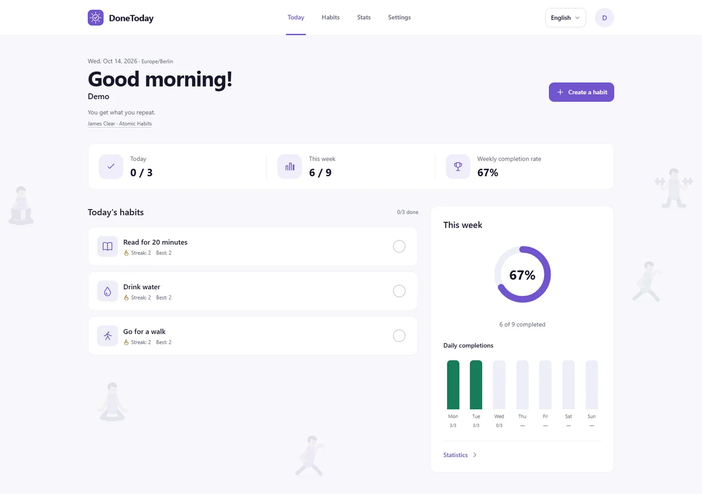
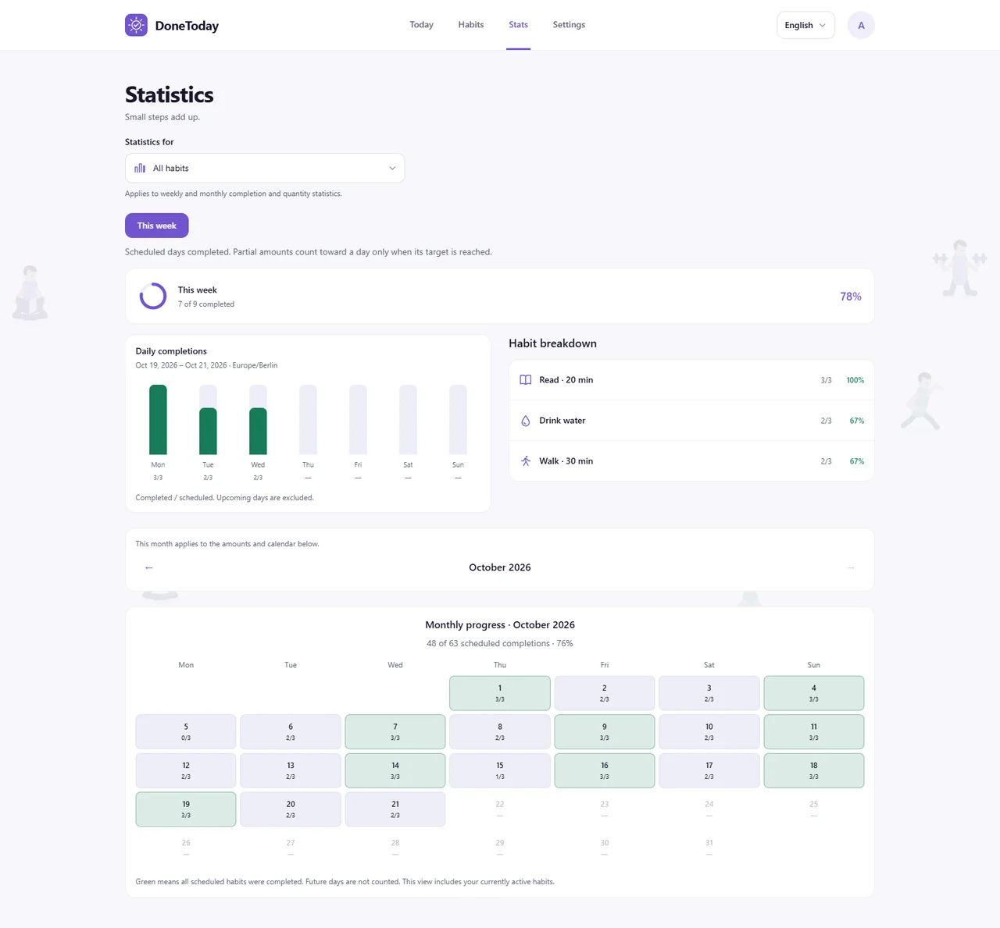
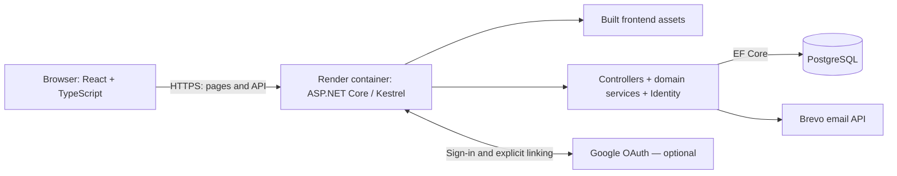

# DoneToday

[](https://github.com/EliasOlguin/DoneToday/actions/workflows/ci.yml)

A habit tracker for people who want to build routines, record daily progress, and understand their consistency over time.

[Leer en español](README.es.md)

## Screenshots

### Today: scheduled habits, streaks, and weekly progress



### Statistics: daily completions, habit breakdown, and monthly calendar



Screenshots use demo data with a shared reference date of October 14, 2026. The English interface is shown; Spanish and German are also available.

## Live demo

[Open DoneToday](https://donetoday-15xl.onrender.com)

Use the guest option to explore without registering, or create an account with email confirmation. Google sign-in is available when provider credentials are configured.

## Stack

| Area | Technology |
| --- | --- |
| Frontend | React 19, TypeScript 6, Vite 8, Tailwind CSS 4 |
| Navigation and server data | React Router, TanStack Query |
| Languages | i18next and react-i18next; English, Spanish, German |
| Backend | ASP.NET Core 10, Kestrel, Entity Framework Core 10 |
| Database and accounts | PostgreSQL, ASP.NET Core Identity, cookie authentication, optional authenticator 2FA |
| Email | MailKit/SMTP; Brevo for the Render deployment |
| Deployment | Multi-stage Docker build; frontend assets served by the API on Render |
| Tests | xUnit, Vitest, Testing Library, Node.js test runner |

## Technical decisions

| Decision | Why it matters | Code to inspect |
| --- | --- | --- |
| **One time zone per account.** Habit dates use a saved IANA zone, with UTC as fallback; the first browser detection does not overwrite an existing preference. | Two devices agree on what “today” means, including around midnight and daylight-saving changes. | [UserDateService](DoneToday/Services/UserDateService.cs), [ProfileController](DoneToday/Controllers/ProfileController.cs), [tests](DoneToday.Tests/Services/UserDateServiceTests.cs) |
| **Schedule changes preserve the past.** Existing schedules end today and replacements start tomorrow. Streaks use the schedule valid on each date. | Editing a routine does not retroactively change the days on which it was expected. | [HabitScheduleService](DoneToday/Services/HabitScheduleService.cs), [StreakService](DoneToday/Services/StreakService.cs), [tests](DoneToday.Tests/Services/HabitScheduleServiceTests.cs) |
| **Guest conversion requires both browser and email proof.** Pending registration is bound to the guest account, browser secret, security stamp, and expiry. Confirmation retains the account and its habits. | Trying the app does not require an email, while claiming the guest's data requires more than opening a confirmation link. | [GuestRegistration](DoneToday/Services/GuestRegistration.cs), [confirmation flow](DoneToday/Controllers/AuthController.cs), [integration tests](DoneToday.Tests/Services/GuestSecurityIntegrationTests.cs) |
| **Quantity recording handles retries and conflicting edits.** Operation IDs prevent duplicate additions; corrections check a revision, and writes are serialized per habit in a database transaction. | Retrying after a network failure does not add the same amount twice, and a stale correction is rejected. | [HabitProgressController](DoneToday/Controllers/HabitProgressController.cs), [database constraints](DoneToday/Data/AppDbContext.cs), [UI recovery tests](DoneToday.Web/tests/ux-flows.ui.test.tsx) |
| **Secondary pages and translations load on demand.** Today stays in the entry bundle; other pages use `React.lazy` with `Suspense`, and language catalogs use dynamic imports. | The first visit avoids downloading every settings, account, and statistics screen and all three catalogs upfront. | [Routes](DoneToday.Web/src/App.tsx), [language loading](DoneToday.Web/src/i18n/index.ts) |

## Architecture



The [Dockerfile](Dockerfile) builds both applications and copies Vite's output to the backend's `wwwroot`. Production serves the UI and API from the same origin. Domain services calculate streaks and progress; controllers enforce ownership and coordinate database writes. See [deployment configuration](docs/deployment.md) and [security controls and limits](docs/security.md).

## Local setup

Requirements: .NET SDK 10, Node.js 24 with npm, and PostgreSQL. Start in the repository root. Use a dedicated development database; do not point these commands at production.

### 1. Configure the database

Create a database named `donetoday_auth` with your PostgreSQL tools, then run:

```bash
dotnet restore
dotnet user-secrets set "ConnectionStrings:AuthenticationConnection" "Host=localhost;Port=5432;Database=donetoday_auth;Username=YOUR_USER;Password=YOUR_PASSWORD" --project DoneToday
```

The app uses `AuthenticationConnection`. If you retain an old `DefaultConnection`, it must name a different database: [the connection selector](DoneToday/Data/AuthenticationDatabase.cs) rejects reusing the previous demo database.

Install the EF Core CLI if needed and apply migrations in Development:

```bash
dotnet tool install --global dotnet-ef --version "10.*"
dotnet ef database update --project DoneToday -- --environment Development
```

### 2. Start the API

```bash
dotnet dev-certs https --trust
dotnet run --project DoneToday --launch-profile https
```

API: `https://localhost:7154/api`. Development Swagger: `https://localhost:7154/swagger`.

### 3. Start the frontend

In another terminal:

```bash
cd DoneToday.Web
npm ci
npm run dev
```

Open `https://localhost:5173`. The `predev` script exports the .NET development certificate for Vite; the development proxy forwards `/api` to the API's HTTPS address. See [Vite configuration](DoneToday.Web/vite.config.ts).

Guest access works without an email service. For registration and password recovery, development settings use a local SMTP inbox at `127.0.0.1:1025`. On Windows, start the repository's Mailpit helper in another terminal:

```powershell
powershell -NoProfile -File tools/start-mailpit.ps1
```

Read confirmation messages at `http://127.0.0.1:8025`. See [local email setup](docs/authentication.md) for details. Google is optional; it is enabled only when `Authentication:Google:ClientId` and `Authentication:Google:ClientSecret` are supplied through local secrets or environment configuration.

## Tests and checks

[GitHub Actions](.github/workflows/ci.yml) runs backend tests and frontend checks on pushes to `main`, pull requests, and manual runs. The CI badge above links to the results. The workflow does not configure PostgreSQL, so the opt-in database integration tests described below remain skipped.

From the repository root:

```bash
dotnet test
```

From `DoneToday.Web`:

```bash
npm ci
npm run lint
npm run build
npm run test:i18n
npm run test:ui
```

Backend tests cover scheduling, streaks, account dates, progress, and security behavior. UI tests cover editing, recovery from failed requests, navigation protection, and language formatting; catalog tests check language detection, key completeness, and interpolation variables.

The PostgreSQL security integration tests are opt-in: without `DONETODAY_SECURITY_TEST_CONNECTION`, they are skipped. Supply a connection to a **disposable local PostgreSQL server**, with database creation privileges, to run them; the harness creates and drops its own test database. See [the integration test harness](DoneToday.Tests/Services/GuestSecurityIntegrationTests.cs). Stop a running local API if Windows reports locked build files.

## API overview

Habit, profile, and progress routes require an authenticated account, including guest accounts. State-changing requests require a CSRF token: obtain it from `GET /api/auth/csrf`, retain the cookies, and send `X-CSRF-TOKEN`. This table summarizes the main routes; development Swagger exposes request schemas.

| Method | Route | Purpose |
| --- | --- | --- |
| POST | `/api/auth/guest` | Start a guest session |
| POST | `/api/auth/register`, `/api/auth/confirm-email` | Register and confirm an email account |
| POST | `/api/auth/login`, `/api/auth/two-factor/login`, `/api/auth/logout` | Sign in, complete 2FA, and sign out |
| POST | `/api/auth/forgot-password`, `/api/auth/reset-password` | Request and complete password recovery |
| POST | `/api/auth/guest/register` | Begin conversion of the current guest account |
| GET | `/api/auth/me`, `/api/auth/csrf` | Read the session and obtain a CSRF token |
| GET | `/api/Today` | Today's scheduled habits, progress, and streaks |
| GET / POST | `/api/Habits` | List active habits / create a habit |
| GET / PUT | `/api/Habits/{id}` | Read / update an owned habit |
| GET | `/api/Habits/{id}/detail` | Schedule, streaks, and completion dates |
| POST / DELETE | `/api/Habits/{id}/complete` | Complete / undo today's completion |
| POST / PUT | `/api/Habits/{id}/progress` | Add an amount / correct today's total |
| PATCH | `/api/Habits/{id}/archive`, `/api/Habits/{id}/restore` | Archive / restore a habit |
| GET | `/api/Habits/archived` | List archived habits |
| POST | `/api/Habits/order` | Save active habit order |
| GET | `/api/Progress/week`, `/api/Progress/month` | Completion statistics; optional `habitId`, and `year`/`month` for monthly data |
| GET | `/api/Progress/quantities` | Quantity statistics; optional `habitId`, `year`, and `month` |
| POST | `/api/profile/name`, `/api/profile/time-zone` | Update the display name / account time zone |
| POST | `/api/profile/delete` | Verify and permanently delete the current account |

More detail: [measurable habits](docs/measurable-habits.md), [UX behavior](docs/ux-improvements.md), [frontend guide](DoneToday.Web/README.md). Release history lives in [CHANGELOG.md](CHANGELOG.md).
